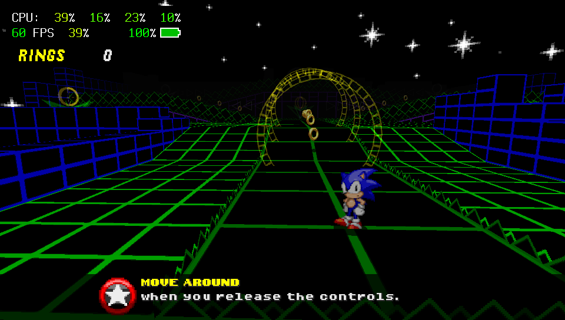
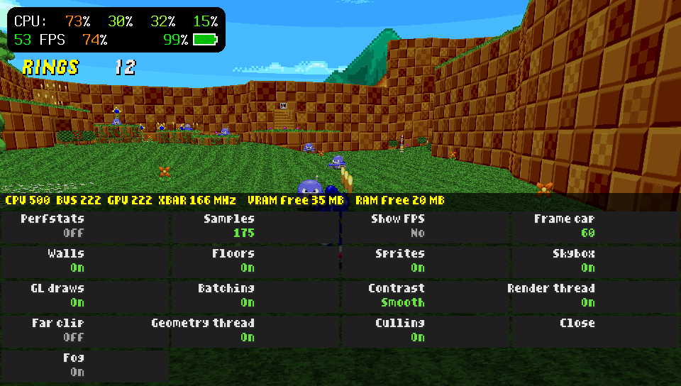

# Sonic Robo Blast 2 for PS Vita

This is a port of [Sonic Robo Blast 2](https://www.srb2.org/) v2.2.15 to the PlayStation Vita. It uses SRB2's own OpenGL renderer running on top of [vitaGL](https://github.com/Rinnegatamante/vitaGL). Menus, levels, saves, music and sound all work on real hardware, and most of the effort went into getting it to run at a playable frame rate.

## Features and mods

The full single player game is playable, and so are addons. Put `.pk3`/`.wad` files in `ux0:data/srb2/addons` and load them from the Addons menu as usual. I tested the Sonic Adventure and Sonic Heroes character mods and both worked great.

Multiplayer is built in (netplay needs curl in 2.2.15, so it is compiled with it), but I never tested it, so consider it unsupported for now. Rumble and the on-screen keyboard are not implemented, which means you can't type names or console commands with the system keyboard.

Recommended settings are the defaults: OpenGL renderer at 960x544, the frame cap at 30 ("Match refresh rate" with vsync on), the render thread and culling on, and texture filter Nearest. Since 0.5.1 the whole level is drawn by default (`fullvisibility on`), without the far clip and fog from 0.5.0. If you prefer the old look with more FPS in big outdoor levels, type `fullvisibility off` in the console and the far clip and fog settings from the debug menu apply again.

## Controls

The Vita buttons are mapped to the gamepad layout SRB2 expects, so the default controls work and everything can be rebound in Options. Cross, Circle, Square and Triangle are A, B, X and Y, L and R are the bumpers, Start and Select are Start and Back. In menus, Cross confirms, Circle goes back and Triangle answers "no". Menu prompts and the tutorial show the Vita button names.

<p align="center">
  
</p>

Touching the top right corner of the screen opens the debug menu over the bottom half of the screen, while the game keeps running. From there you can change the FPS limit (30 or 60), show the FPS counter and SRB2's perfstats, and toggle far clip, fog, culling, the skybox, the render thread, the geometry thread, batching and a few things used for testing (walls, floors, sprites, draw submission). It also shows the real CPU/GPU clocks and free memory. Tap above the panel or on Close to hide it.

<p align="center">
  
</p>

## Performance

On the Vita the slow part is not the drawing, it's the game logic. SRB2 runs every object in the whole level 35 times a second, even when it's far away and nothing is happening to it. Deep Sea Zone, for example, has well over a thousand spikes that check their collision every tic. A PC does that in a couple of milliseconds, the Vita's Cortex-A9 needs 40 or 50, and a tic only has 28.5 ms.

0.5.1 is mostly about that:

- **Sleeping objects.** Things far from the player that aren't moving and aren't being touched by anything (spikes, scenery, decorations) stop thinking until the player gets close, something hits them or the floor under them moves. Players, enemies, bosses, missiles, platforms you can ride and anything a Lua script hooks into never sleep. This is the `vitadormant` option, on by default in single player. The wake distance is `dormantdist` (4096 by default). It turns itself off in netgames and while recording or playing demos, because a sleeping object makes the game run slightly differently than on PC, and demos and netplay need both to match exactly.
- **Cheaper collision checks.** Most of the objects a collision check looks at are too far away to touch. The check now throws those out first, before reading anything else about them, and the fields it reads sit together in memory so the Vita's small cache misses less. Looking up which subsector a point is in is cached too, since the same spots get asked about over and over. These changes don't alter the game at all, demos recorded on PC still play back the same.
- **Less work on weather.** Rain and snow particles are only updated when they actually need it.

Every map below was measured on a real Vita (OpenGL, 960x544, 60 FPS cap) with the built-in benchmark, 10 seconds per map with the camera turning a full circle so every side of the start gets drawn. "Game speed" is how fast the game runs compared to real time: 100% means it keeps up, 50% means everything moves at half speed. When the logic can't keep up the game runs several tics per frame, which is why a heavy map can show a low FPS with a decent game speed. "Before" is the same benchmark on the build right before these changes.

| Map | Level | FPS before | FPS 0.5.1 | 1% low (ms) | Game speed before | Game speed 0.5.1 |
| --- | --- | ---: | ---: | ---: | ---: | ---: |
| MAP01 | Greenflower Act 1 | 48.6 | 48.8 | 133.5 | 98% | 98% |
| MAP02 | Greenflower Act 2 | 46.2 | 46.4 | 152.0 | 97% | 97% |
| MAP03 | Greenflower Act 3 | 58.6 | 58.6 | 47.9 | 100% | 100% |
| MAP04 | Techno Hill Act 1 | 51.7 | 54.0 | 71.4 | 100% | 100% |
| MAP05 | Techno Hill Act 2 | 46.4 | 47.1 | 75.1 | 100% | 98% |
| MAP06 | Techno Hill Act 3 | 59.7 | 59.7 | 19.0 | 100% | 100% |
| MAP07 | Deep Sea Act 1 | 10.4 | 15.2 | 186.4 | 83% | 96% |
| MAP08 | Deep Sea Act 2 | 7.4 | 9.7 | 215.8 | 49% | 64% |
| MAP09 | Deep Sea Act 3 | 58.2 | 58.2 | 62.8 | 99% | 99% |
| MAP10 | Castle Eggman Act 1 | 7.1 | 10.0 | 205.0 | 47% | 81% |
| MAP11 | Castle Eggman Act 2 | 6.4 | 7.9 | 678.8 | 40% | 52% |
| MAP12 | Castle Eggman Act 3 | 27.5 | 28.3 | 142.9 | 100% | 98% |
| MAP13 | Arid Canyon Act 1 | 8.1 | 13.3 | 464.1 | 57% | 84% |
| MAP14 | Arid Canyon Act 2 | 6.8 | 8.1 | 324.6 | 44% | 55% |
| MAP15 | Arid Canyon Act 3 | 56.1 | 56.6 | 118.5 | 96% | 96% |
| MAP16 | Red Volcano Act 1 | 9.3 | 9.9 | 177.1 | 67% | 88% |
| MAP22 | Egg Rock Act 1 | 44.5 | 46.2 | 68.6 | 100% | 99% |
| MAP23 | Egg Rock Act 2 | 7.4 | 10.0 | 229.1 | 49% | 83% |
| MAP25 | Black Core Act 1 | 52.7 | 52.9 | 60.8 | 100% | 100% |
| MAP26 | Black Core Act 2 | 59.2 | 59.2 | 35.5 | 99% | 100% |
| MAP27 | Black Core Act 3 | 47.1 | 47.6 | 141.7 | 95% | 96% |

The total logic time over the 21 maps went from 440 ms to 328 ms per tic, about 25% less. Most maps already ran at full speed and stay there. The ones that improved most are Castle Eggman 1, Arid Canyon 1, Egg Rock 2 and Red Volcano 1. Deep Sea 2, Castle Eggman 2 and Arid Canyon 2 are still slow. Castle Eggman 2 and Arid Canyon 1 also spend a lot of time drawing (around 17 to 23 ms per frame), so they need renderer work too, not only logic.

### Running the benchmark yourself

Create `ux0:data/srb2/benchmark.txt` and start the game. It skips the intro, plays each map for 10 seconds, writes `ux0:data/srb2/benchmark-result.txt` and quits. The file is deleted when the benchmark starts. An empty file runs the 21 maps above. Each line can also be a map (`MAP08` or `8`), `addon <path>` to load an addon first, `demo <file>` to play a demo instead of a map, or `profile` for a per-object breakdown (the profiler adds its own overhead, so don't compare its times with a normal run). If you see the intro, the file wasn't picked up.

`tools/vita_bench_report.py benchmark-result.txt build/srb2` turns a result file into a table (the ELF is used to name thinker functions), and `tools/vita_bench_compare.py` compares two or more result files map by map.

## What was changed

All SRB2 source changes are wrapped in `#ifdef __vita__`, so `grep -rln __vita__ SRB2-master/src` finds them. The Vita-only files are in `SRB2-master/src/vita/`. The build uses its own `CMakeLists.txt` and not SRB2's CMake.

**Platform.** `vita/i_video.c` replaces SDL's video code: it starts vitaGL, handles video modes, joystick input with the button remap, frame pacing, and shows errors with the system message dialog (SDL message boxes start their own GXM renderer and crash). The game sets the clocks to 444/222/222/166 MHz and checks them again every 60 frames, because the system restores lower clocks after suspend. Data is read from `ux0:data/srb2` (or `uma0:data/srb2`), configs and saves go there too, and logs go to `ux0:data/srb2/logs`. Since 0.5.1 vitaGL's shader cache and logs live in `ux0:data/srb2` as well, so nothing is written to the root of `ux0:data` anymore. The heap is 256 MB with extended memory enabled.

**Rendering.** GLSL shaders are disabled and the game uses the fixed function path. The biggest early problems were GPU stalls: SRB2 copies the screen into textures with `glCopyTexSubImage2D`, which on vitaGL reads the frame back to the CPU. Now everything renders into an offscreen framebuffer and those copies are framebuffer blits, which fixed the slowdown underwater. SRB2 also keeps blending and alpha test on for every draw, which kills the Vita GPU's hidden surface removal, so opaque surfaces with opaque textures now draw with both turned off. Vertices are copied into vitaGL's per-frame scratch memory instead of being sent as client arrays, which Rinnegatamante recommended. vitaGL's data pool now hands out 8 byte aligned slots, an odd sized index buffer could misalign everything after it and crash on the next VFP store.

**CPU work.** After the GPU fixes the game was CPU bound. The Cortex-A9 has no integer divide, so the fixed point divisions used everywhere now go through the VFP in double precision with an exact correction (tested on PC against the original over hundreds of millions of cases, so game logic and demos stay identical). Other changes found with a sampling profiler: cached sort keys for sprites, a merge instead of a sort for translucent surfaces, cached lighting values, fewer repeated angle calculations, prefetching thinkers on the slow memory, and splitting the mobj interpolation work with a second core. Boot time on the console went from 3-5 minutes to under a minute, mostly by caching reads from the memory card and skipping work on music-only files. The logic changes in 0.5.1 are described in the Performance section.

**Threads.** A render thread on the second core replays the frame's GL calls through vitaGL while the game prepares the next frame. This took the GFZ2 start from about 23 to 30 FPS on hardware, at the cost of one frame of input lag. First-time texture uploads are also done by that thread now, which removed small hitches in menus. A level geometry thread that builds walls and floors on the third core is also in, but I could not prove that it really helps on hardware, so it can be turned off in the debug menu.

**Culling.** SRB2's OpenGL renderer has no real occlusion culling: it only checks left and right with a generous margin and only treats solid walls as blocking. I tightened the view check, added vertical "clip windows" (the same idea as the software renderer's floor and ceiling clipping) so geometry hidden behind wall openings is skipped, and made the skybox render only when sky is actually visible.

**Far clip and fog.** With `fullvisibility off`, far clip stops drawing level geometry beyond a distance, which helps a lot in open levels (the worst GFZ2 spot went from 23 to 43 FPS at 3072), and a linear fog fades into the sky's horizon color so the cut doesn't show.

**Menus.** Screens without a level run at 60 Hz when possible, because their animations step 35 times a second and 30 Hz drops a step every few frames. If the Vita can't keep up it goes back to 30 Hz automatically.

## Building

You need [VitaSDK](https://vitasdk.org/) (with `VITASDK` set, default `/usr/local/vitasdk`), CMake, git, curl, unzip and Python 3. Then run:

```sh
tools/build.sh
```

This clones vitaGL into `tools/vitaGL` at a pinned commit (newer vitaGL needs a newer vitashark than the SDK has), applies the small changes in `tools/patch_vitagl.py`, builds it, generates the LiveArea images and builds `build/srb2.vpk`.

## Installing

Install `srb2.vpk` with VitaShell. Then run `tools/make_data.sh`, which downloads the official 2.2.15 release and unpacks the game data into `data/srb2`, and copy that folder to `ux0:data/srb2`. Copying `data/shader_cache` to `ux0:data/srb2/shader_cache` is optional, it contains precompiled shaders so the first frames don't stall (an old copy in `ux0:data/shader_cache` is still read). You also need `libshacccg.suprx` in `ur0:data/`, since vitaGL compiles shaders at runtime. A console with HENkaku or Ensō is required.

## Known issues

Netplay is untested. The software renderer works but the intro scenes show a white background without the story text. There is no system keyboard for text input. Some menu animations and level title cards can still hitch slightly the first time new shaders are compiled. Deep Sea 2, Castle Eggman 2 and Arid Canyon 2 are still limited by game logic. With sleeping objects on, a mod object that only does its own thing far away from the player without using Lua hooks can pause until you get close; turn `vitadormant off` if a mod behaves oddly.

## Credits and notes

Sonic Robo Blast 2 is made by Sonic Team Junior. vitaGL is by Rinnegatamante, who also gave advice on vertex submission and culling.

Claude was a major help on this project. SRB2's code is big and complicated, and finding where the time actually goes on the Vita, and changing it without breaking the game logic, was a lot harder than I expected.

Parts of the code were written or improved with the assistance of AI (Claude, by Anthropic). All AI-assisted code was reviewed, tested, and manually validated, with the overall implementation and debugging process remaining under human supervision.

## License

SRB2 is © Sonic Team Junior and is distributed under the GNU General Public License v2 (see `SRB2-master/LICENSE`). The changes in this port are released under the same license. Sonic the Hedgehog and related characters are trademarks of SEGA. The game data is not included in this repository; `tools/make_data.sh` downloads it from the official release.
